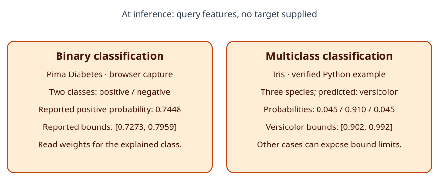
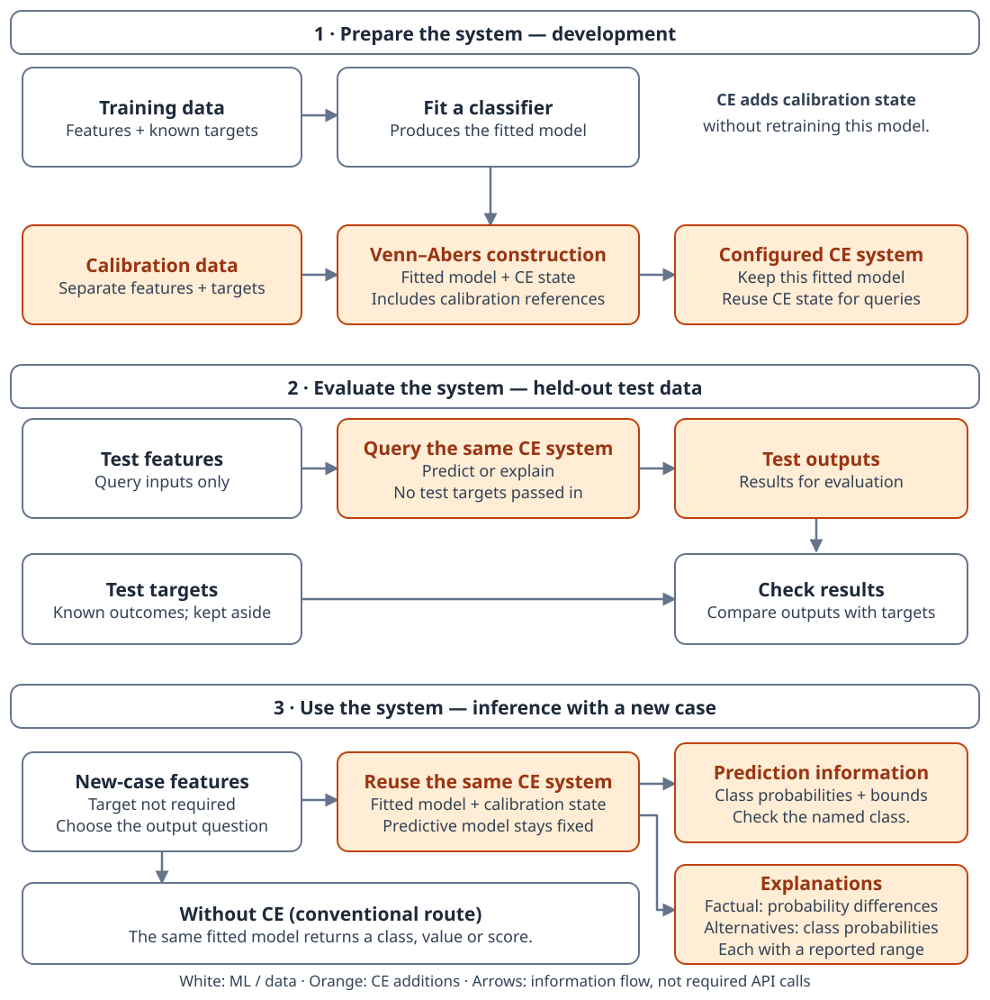

# Classification: read a prediction

<span class="ce-choice-page" hidden></span>

A classifier predicts a category. The Diabetes example has two classes
(**binary**); the Iris example has three species (**multiclass**).

**Goal:** read one prediction and its reported range, then inspect the feature
conditions and alternative predictions that help explain the model's response.

## Choose where to run it

**In the browser — binary Diabetes.** No installation is needed. Follow the
{ref}`Expert Hub Diabetes exercise <expert-classification>`: select the dataset,
prepare and calibrate, then inspect one test case. This is the simplest starting
route if you do not have a Python environment ready.

**In Python — multiclass Iris.** Follow {doc}`First explanation in Python <first-python-explanation>`.
It includes installation, explained code cells, verified output and a plot.
The target is one of three flower species. For further calls afterward, use the
{doc}`classification tutorial <quickstart_classification>`.

## Read the binary result

A captured Diabetes case reports **positive probability 0.7448**, with bounds
**[0.7273, 0.7959]**. Read “positive” first: this identifies the class whose
probability is displayed. This is an educational model output, not a diagnosis.

Here, `plas` is the dataset’s glucose feature. The factual condition
`plas > 139.50` has weight **+0.517**, range
**[0.510, 0.538]**. That weight is a model-response difference; it is not another
patient probability. The alternative `plas < 147.50` reports probability
**0.2719**, bounds **[0.2487, 0.2811]**. It describes the model under a different
condition, not the effect of a medical intervention.

These are dated results from the {doc}`browser guide <expert-hub>`; your session
can differ. Keep its screenshot open while identifying the three quantities.

## Read the multiclass result

The Python example reports **0.045, 0.910, 0.045** in the order **setosa,
versicolor, virginica**. Versicolor has the largest probability; its reported
bounds are **[0.902, 0.992]**. The factual explanation concerns that class.
When reading an alternative, check which class its prediction refers to rather
than assuming a generic “positive class”. These are different data and software
from the browser case; their values are not a performance comparison.

```{warning}
The reviewed source can return multiclass bounds outside `[0, 1]` for other
queries. This illustrated case does not resolve that limitation. Do not clip
bounds or transfer the binary interpretation unchanged to multiclass normalization.
See the {doc}`classification tutorial <quickstart_classification>`; exact validity
wording remains for author review.
```

<details><summary>Compare the two captured cases visually</summary>

<picture>
<source media="(max-width: 600px)" srcset="../_static/figures/ce-classification-cases-mobile.svg">

</picture>

[Open the full-size comparison](../_static/figures/ce-classification-cases.svg).

</details>

## Check your understanding

Can you name the predicted quantity, its units and the class or event if applicable?
Can you distinguish the prediction range, a factual weight and an alternative
prediction? If not, use {doc}`Interpret calibrated explanations <../foundations/how-to/interpret_explanations>`
with the result still open. You do not need to learn every API field to read one case.

<details><summary>Go deeper: how this mode produces its outputs</summary>

<span id="see-the-mode-specific-workflow"></span>

**Mode-specific workflow**

<figure>
<picture>
<source media="(max-width: 600px)" srcset="../_static/figures/ce-mode-classification-mobile.svg">

</picture>
</figure>

[Open the full-size figure](../_static/figures/ce-mode-classification.svg).

The arrows show information flow, not a required sequence of API calls.
Prediction and explanation operate on the same calibrated system; the
explanation call can obtain its own prediction. Read the result in this mode's
units and keep the prediction range separate from a feature-weight range.
For exact assumptions and limitations, use
{doc}`calibrated interval semantics <../foundations/concepts/calibrated_interval_semantics>`.


</details>

## Semantics for this example

- **Mode:** Classification (Venn–Abers).
- **Calibration prerequisites:** a fitted model and separate labelled calibration data.
- **Guarantees:** use the method-specific statements in {doc}`calibrated interval semantics <../foundations/concepts/calibrated_interval_semantics>`.
- **Assumptions:** check the mode’s sampling conditions and calibration/deployment relationship there.
- **Non-guarantees:** no individual-case certainty or unconditional protection under drift.
- **Feature-level limits:** weight ranges are not causal or universal per-feature coverage guarantees.


## Continue from this result

**Try another question:** return to {doc}`the big picture <index>`.
**Understand the construction:** {doc}`How CE Works <../sections/how-ce-works>`.
**Adapt to your data:** {doc}`Checking results <../practitioner/check_results>`.
**Find the exact call:** {doc}`Quick API <quick_api>`.

<!-- Entry-point tier: Tier 2. -->

<!-- Preserve previous section links. -->
<span id="binary-and-multiclass-the-same-task-different-class-sets"></span>
<span id="continue-from-the-result"></span>
<span id="read-your-result"></span>

<span id="classification-explain-a-class-prediction"></span>
