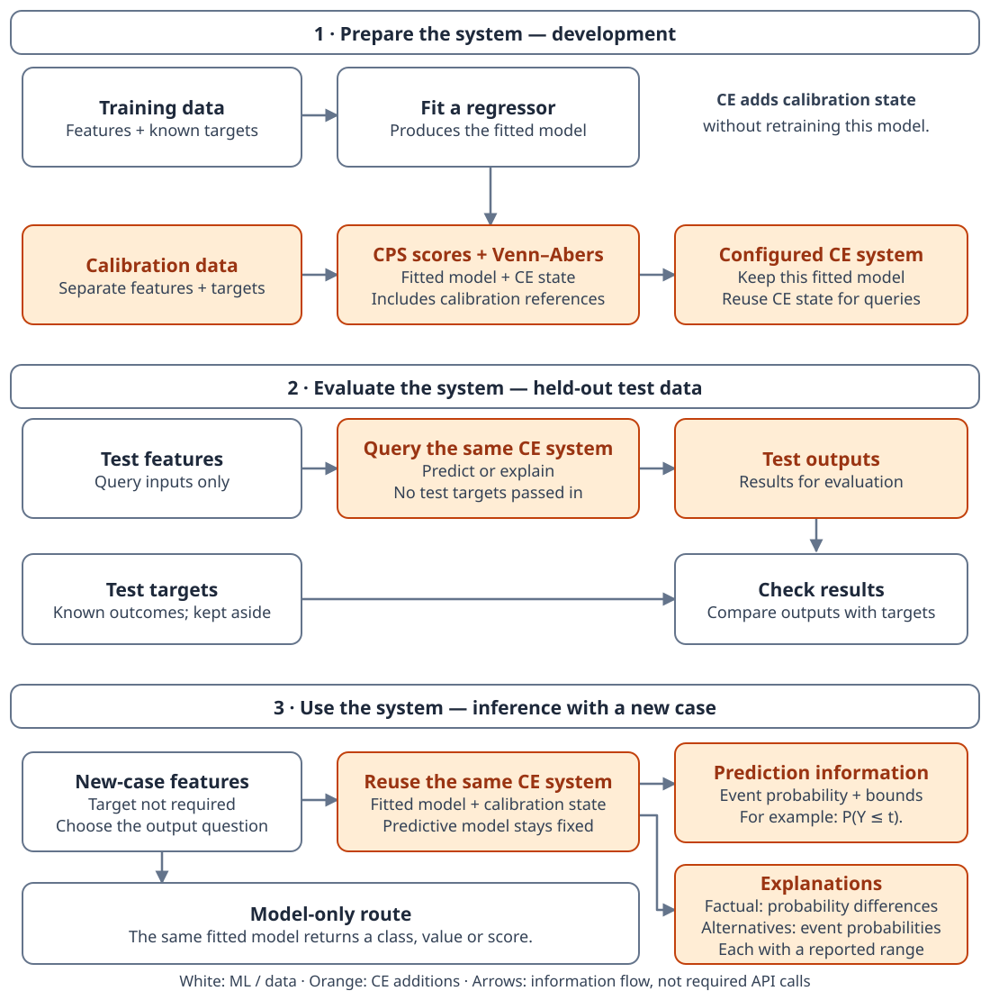

# Event probabilities: first result

**Goal:** define an event on a numerical target, then read its probability and
bounds. This is probabilistic regression. The question has changed from “What value?”
to “How probable is this event?”

## Choose where to run it

Choose one environment. The browser and Python examples use different datasets;
follow the selected guide's labels, units and setup. You can also read the captured
results below without running either route.

<a class="ce-route-card" href="expert-hub.html#expert-event"><strong>Browser: housing event</strong>Define the housing threshold, then inspect its probability.Open the browser guide →</a>
<a class="ce-route-card" href="quickstart_regression.html"><strong>Python: disease-progression event</strong>Run the tutorial from setup through the event-probability section.Open the Python example →</a>

**Before running:** for the housing event, enable **Use Threshold** and enter **3**
for $300,000, not 300000. The browser guide flags a misleading interval badge;
read the event definition and raw probability values. In Python, run from setup
through “Ask for an event probability”. Its event is `Y <= 150` on a different
target. Pass the same threshold to factual and alternative calls; target-value
weights must not be reused as event-probability weights.

## Read the housing event result

The event is **Y ≤ 3**: median housing value at most **$300,000**. One captured
case reports probability **0.9986**, with bounds **[0.9986, 1.0000]**.
These are probability quantities. They are neither a predicted house value nor
a dollar-valued interval. A high probability does not make the event certain.

A captured alternative, `Longitude < -121.63`, reports **0.9331**, bounds
**[0.9319, 0.9418]**. Compare this with the original event probability. A factual
weight instead measures a probability difference for the event. Neither explains
the causal effect of relocating an area.

These numbers come from the dated {doc}`Expert Hub guide <expert-hub>`.
The Python tutorial's output identifies both the requested event probability and
its complement; read the column labels before selecting a number.

## Check your understanding

Can you name the predicted quantity, its units and the class or event if applicable?
Can you distinguish the prediction range, a factual weight and an alternative
prediction? If not, use {doc}`Interpret calibrated explanations <../foundations/how-to/interpret_explanations>`
with the result still open. You do not need to learn every API field to read one case.

Go deeper: how this mode produces its outputs

**Mode-specific workflow**

<figure>
<picture>
<source media="(max-width: 600px)" srcset="../_static/figures/ce-mode-event-mobile.svg">

</picture>
</figure>

[Open the full-size figure](../_static/figures/ce-mode-event.svg).

The arrows show information flow, not a required sequence of API calls.
Prediction and explanation operate on the same calibrated system; the
explanation call can obtain its own prediction. Read the result in this mode's
units and keep the prediction range separate from a feature-weight range.
For exact assumptions and limitations, use
{doc}`calibrated interval semantics <../foundations/concepts/calibrated_interval_semantics>`.

## Semantics for this example

- **Mode:** Probabilistic regression (CPS + Venn–Abers).
- **Calibration prerequisites:** a fitted model and separate labelled calibration data.
- **Guarantees:** use the method-specific statements in {doc}`calibrated interval semantics <../foundations/concepts/calibrated_interval_semantics>`.
- **Assumptions:** check the mode’s sampling conditions and calibration/deployment relationship there.
- **Non-guarantees:** no individual-case certainty or unconditional protection under drift.
- **Feature-level limits:** weight ranges are not causal or universal per-feature coverage guarantees.

## Continue from this result

**Try another question:** return to {doc}`the big picture <index>`.
**Understand the construction:** {doc}`How CE Works <../sections/how-ce-works>`.
**Adapt to your data:** {doc}`Checking results <../practitioner/check_results>`.
**Find the exact call:** {doc}`Quick API <quick_api>`.

<!-- Entry-point tier: Tier 2. -->

<!-- Preserve previous section links. -->

