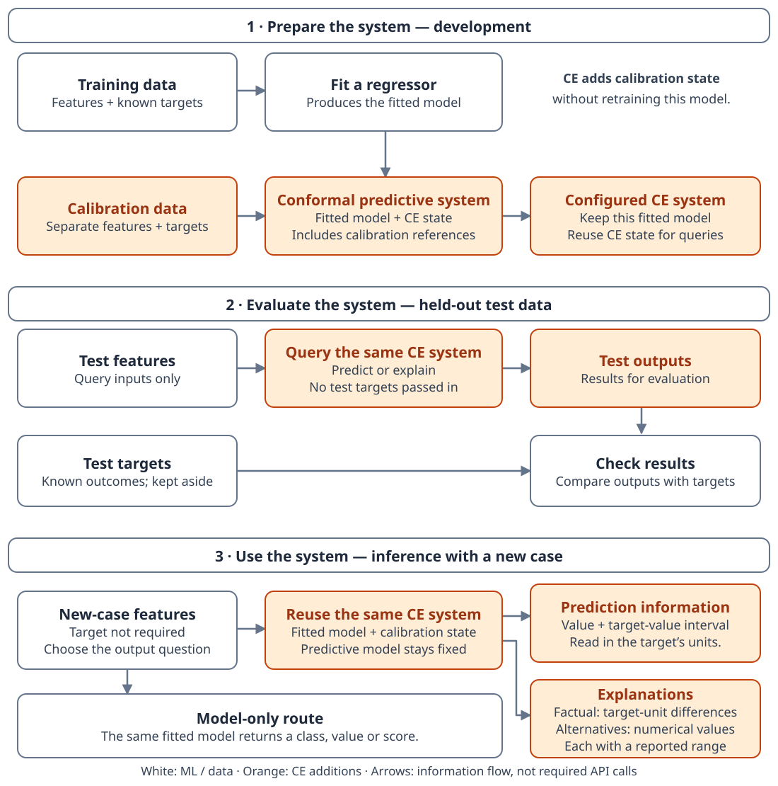

# Interval regression: explain a numerical prediction

**Your question:** What value is predicted, and which target-value interval is reported?

The browser example uses California Housing. Its target is median housing value in units of $100,000: 0.517 corresponds to $51,700. The existing local regression tutorial uses a different numeric diabetes target; retain its own units.

## See the mode-specific workflow

<figure>
<picture>
<source media="(max-width: 600px)" srcset="../_static/figures/ce-mode-interval-mobile.svg">

</picture>
</figure>

[Open the full-size figure](../_static/figures/ce-mode-interval.svg).

The arrows show information flow, not a required sequence of API calls.
Prediction and explanation operate on the same calibrated system; the
explanation call can obtain its own prediction. Read the result in this mode's
units and keep the prediction range separate from a feature-weight range.
For exact assumptions and limitations, use
{doc}`calibrated interval semantics <../foundations/concepts/calibrated_interval_semantics>`.

## Choose where to run it

### In your browser

No installation is needed. Follow the {ref}`Expert Hub guide: California Housing value prediction <expert-interval>`.
The linked section follows classification setup. Select California Housing, repeat preparation/calibration, and inspect a test case without enabling Use Threshold.

The guide contains dated real screenshots, controls and output interpretation.
If the application is unavailable, use those captures or choose the local route.

### Install and run locally

Use {doc}`Installation <installation>` if needed, then follow the existing
{doc}`regression tutorial <quickstart_regression>` from the beginning. It includes data preparation, separate
training/calibration/evaluation roles, model fitting and explanation calls.
At “Interval and threshold predictions”, follow the value-prediction and percentile-interval calls. Leave the event question for the next example.

## Read your result

A numerical prediction and a prediction interval in the target’s units. Read factual differences in those same units. This is not a range for an event probability.

Identify one feature condition, its weight and its range, then one alternative
and its reported prediction. Use {doc}`the shared interpretation guide <../foundations/how-to/interpret_explanations>`
to distinguish them. An alternative describes the model response, not an
established effect of changing the real-world case.

## Semantics for this example

- **Mode:** Interval regression (CPS; no threshold).
- **Calibration prerequisites:** a fitted model and separate labelled calibration data.
- **Guarantees:** use the method-specific statements in {doc}`calibrated interval semantics <../foundations/concepts/calibrated_interval_semantics>`.
- **Assumptions:** check the mode’s sampling conditions and calibration/deployment relationship there.
- **Non-guarantees:** no individual-case certainty or unconditional protection under drift.
- **Feature-level limits:** weight ranges are not causal or universal per-feature coverage guarantees.

## Continue from the result

Return to {doc}`the big picture <index>` to change your question. For the
construction, read {doc}`How explanations are built <../foundations/concepts/how_explanations_are_built>`.
Before adapting an example, use {doc}`Checking results on your data <../practitioner/check_results>`.

Entry-point tier: Tier 2.
