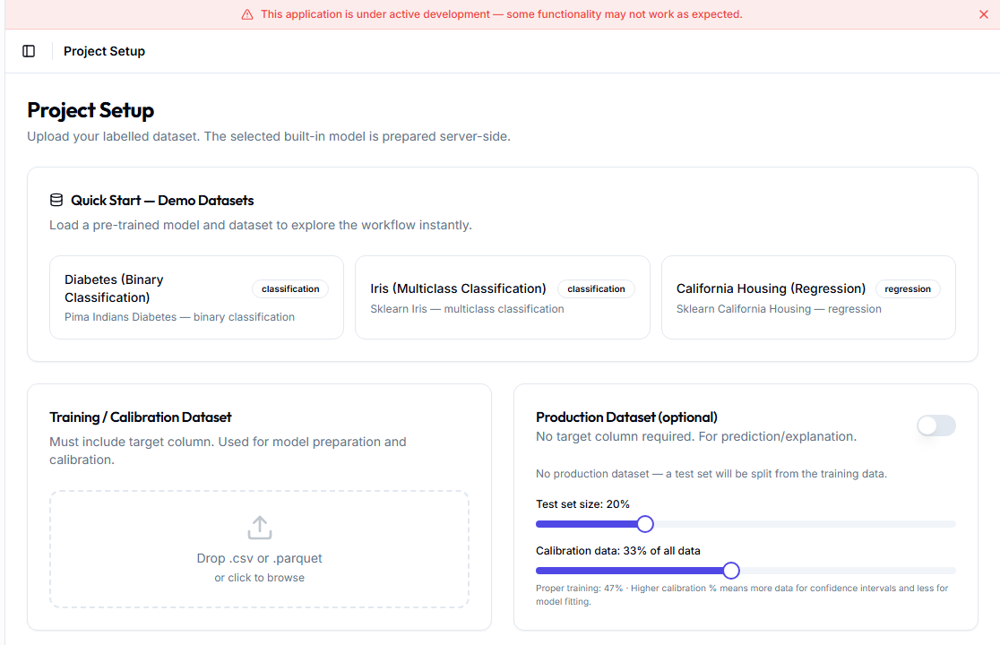
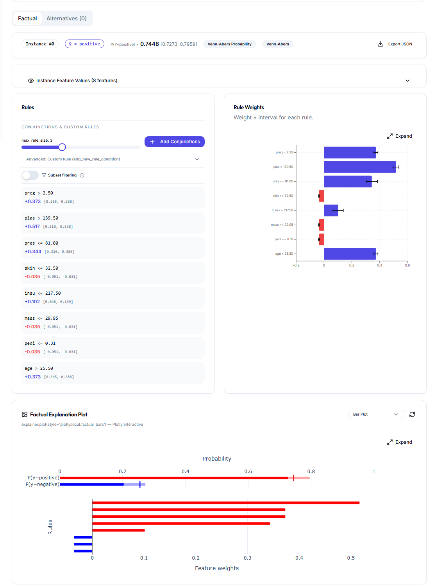
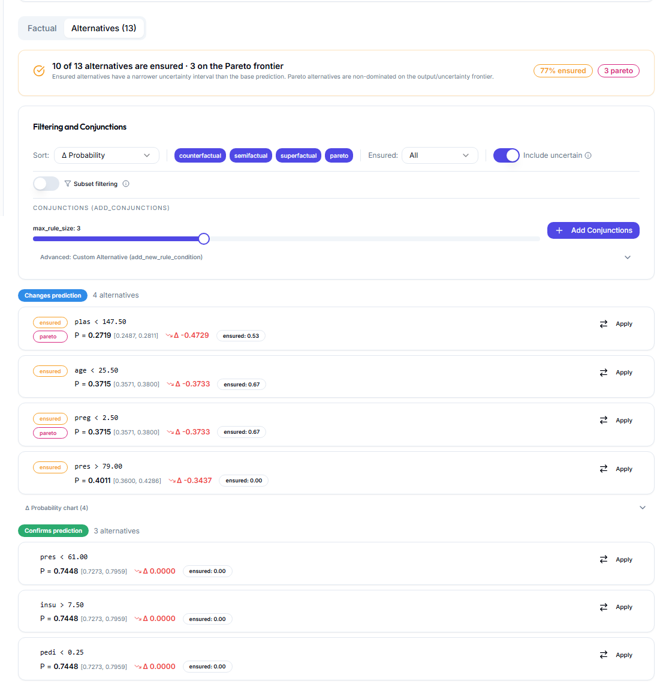
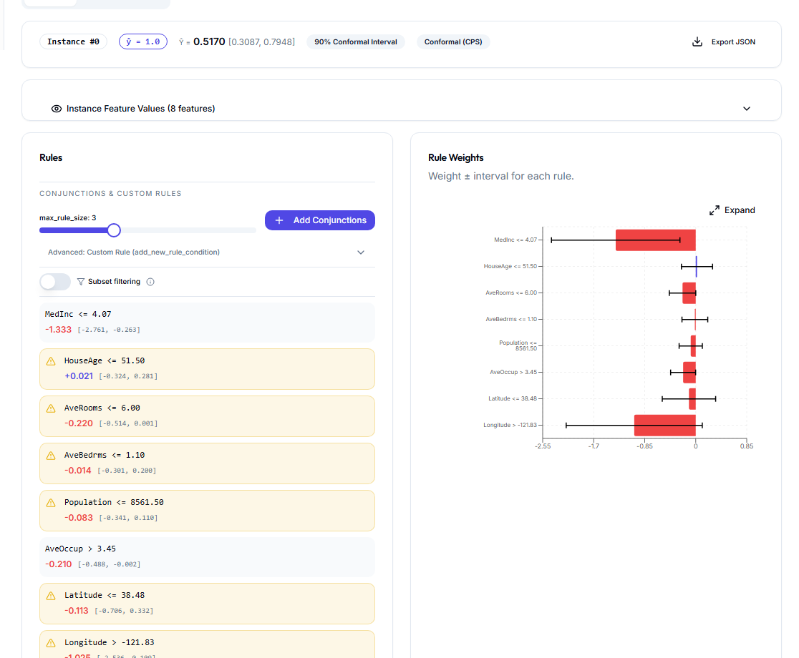
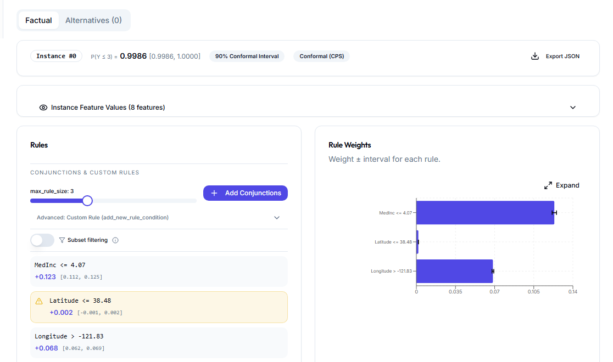
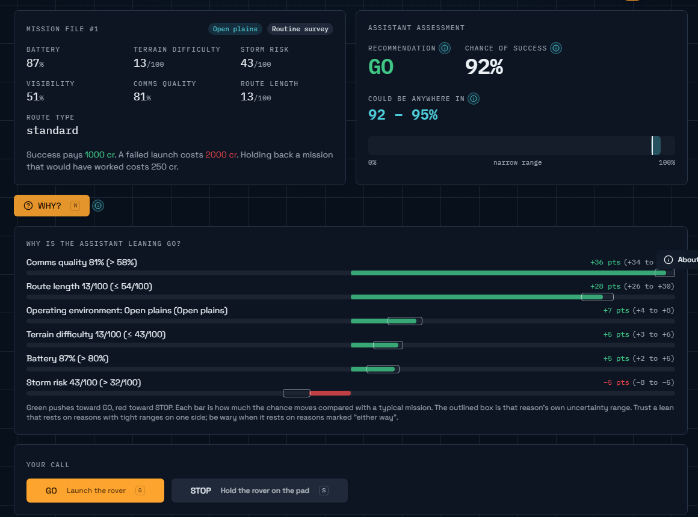
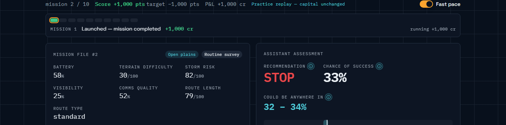
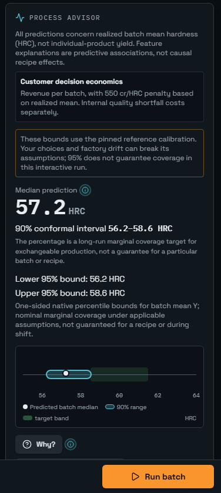
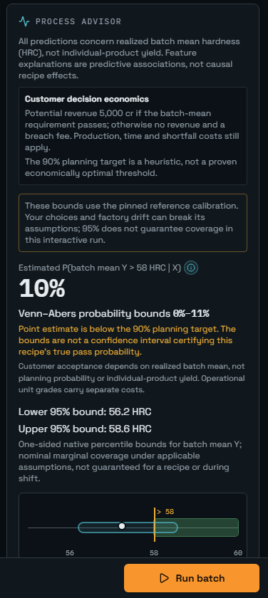

# Get started with Calibrated Explanations

<span id="get-started"></span>

<span id="quick-start-understand-calibrated-explanations-and-create-your-first-explanation"></span>

<span id="where-ce-fits"></span>

<span id="quick-start-understand-explore-and-apply-ce"></span>

<span id="quick-start-understand-ce-and-create-your-first-explanation"></span>

<span id="quick-start-try-ce-in-your-browser"></span>

<span id="try-ce-in-your-browser"></span>

```{raw} html
<nav class="ce-journey" aria-label="Get started, step 2 of 5"><ol><li><a href="../what-is-ce.html"><span class="ce-journey-n">1</span>What CE is</a></li><li aria-current="step"><a href="index.html"><span class="ce-journey-n">2</span>Quick Start</a></li><li><a href="installation.html"><span class="ce-journey-n">3</span>Install</a></li><li><a href="../foundations/how-to/interpret_explanations.html"><span class="ce-journey-n">4</span>Read it</a></li><li><a href="apply-to-your-data.html"><span class="ce-journey-n">5</span>Your data</a></li></ol></nav>
```

**Calibrated Explanations (CE)** is an open-source Python library that explains
individual predictions from supervised machine-learning models, with uncertainty.
It wraps a classification or regression model you already have, calibrates the
model's outputs on labelled data the model has not seen, and then explains each
calibrated prediction, with a range for the prediction and for every feature's weight.

**Get started, step 2 of 5 · about 15 minutes in the browser, or 30 minutes in Python.**
This page shows what CE adds, helps you choose your task and mode, and takes you to
your first explanation in one of two ways. New to CE? Read
{doc}`What CE is <../what-is-ce>` first (5 minutes), or start with section 1 below.

```{raw} html
<nav class="ce-start-here" aria-label="Start here"><span class="ce-start-here-label">Start here:</span> <a href="#qs-path-a">Explore CE in your browser</a> <span aria-hidden="true">·</span> <a href="#qs-python">Install CE locally</a></nav>
```

Sections 1 and 2 take about two minutes and help you choose.

<span id="quick-start-learn-the-ce-workflow-and-read-your-first-explanation"></span><span id="define-a-predictive-task"></span><span id="the-ce-workflow-fit-calibrate-predict-explain-interpret"></span>

<span id="qs-in-60-seconds"></span><span id="qs-predictive-task"></span><span id="ce-in-four-steps-train-calibrate-explain-interpret"></span>

(qs-workflow)=
## 1. Calibrated Explanations in 60 seconds

<span id="ce-in-60-seconds"></span>

**A supervised model makes a prediction.** It has learned from labelled examples (the
*training data*) and now gives an output for a new instance: a class, such as *diabetes:
yes or no*, or a number, such as *a district's median house value*.

**A prediction alone is often not enough.** Two predictions of 0.7 can deserve different
decisions if one is supported within 0.68–0.72 and the other only within 0.4–0.9, and a
bare number does not say which conditions it rests on.

**CE adds calibrated uncertainty and explanations.** Calibrated Explanations uses the
fitted model, without retraining it, together with a separate set of labelled cases the
model was not trained on: the **calibration data**. For the instance you want to
understand, it reports:

1. the **prediction**;
2. **uncertainty information that depends on the task**: lower and upper values for a
   probability, or a prediction interval for a value;
3. a **factual explanation**: *why this prediction?* Which conditions of this instance
   push it up or down, each with a range;
4. **alternative explanations**: *what if one condition were different?*

:::{admonition} Optional background
:class: note

- [Supervised learning, Google for Developers](https://developers.google.com/machine-learning/intro-to-ml/supervised):
  features, labels, training a model and using it to predict.
- [Dividing a dataset, Google for Developers](https://developers.google.com/machine-learning/crash-course/overfitting/dividing-datasets):
  why training and evaluation use separate data. CE's calibration data is a further,
  separate part with its own job: CE uses it, with its labels, to calibrate the model's
  outputs.
- [Probability calibration, scikit-learn](https://scikit-learn.org/stable/modules/calibration.html):
  what it means for a classifier's probabilities to be calibrated.
:::

Other methods can also explain models or estimate uncertainty; CE combines the two in
calibrated outputs. Its explanations describe the model's behaviour, not causes in the
world, and its ranges are not guarantees for an individual case.

```{raw} html
<figure class="ce-figure" id="qs-workflow-figure">
  <a href="../_static/figures/ce-adds-to-workflow.svg" title="Open the figure at full size">
    <picture>
      <source media="(max-width: 600px)" srcset="../_static/figures/ce-adds-to-workflow-narrow.svg">
      
    </picture>
  </a>
  <figcaption><strong>Figure 1. What CE adds to supervised machine learning.</strong> The fitted model is used as it is; CE adds a separate labelled calibration set and returns the prediction with task-specific uncertainty, a factual explanation and alternative explanations. Notice that the two kinds of uncertainty are drawn differently: bounds on a probability (0 to 1) or an interval in the target's units.</figcaption>
</figure>
```

<span id="task-mode-and-capability"></span>

(qs-task-mode-capability)=
## 2. Choose your predictive task and Calibrated Explanations mode

<span id="choose-your-predictive-task-and-ce-mode"></span>

Three words the docs use help you choose:

- the **task** is *what the model predicts*: classification (a class) or regression
  (a number). It is fixed when you choose the estimator and the target;
- the **mode** is *the question you ask and the shape of the answer*: classification
  probabilities, interval regression, or thresholded (probabilistic) regression;
- a **capability** is *an operation you request from the calibrated wrapper*: predict
  with uncertainty, explain factually, explore alternatives, and optionally add
  conjunctions, filter alternatives, guard explanations or flag predictions for review
  (rejection).

The same regressor can serve two modes, depending on the call, because you can ask two
different questions about the same number. The
{doc}`capabilities manifest <../tasks/capabilities>` groups capabilities by mode;
semantics are mode-specific, so a bound means something different in each mode.

::::{grid} 1 1 3 3
:gutter: 3

:::{grid-item-card} Classification
:class-card: ce-path-card

**Question:** Which class is predicted, and how probable is it?

*Example:* Is this patient predicted to have diabetes?

**Output:** the predicted class and a calibrated probability with lower and upper
values, between 0 and 1.

**Explanations:** factual and alternatives, in probability points.

**Try it:** Expert Hub (Diabetes) · Decision Lab (Mission Control)
:::

:::{grid-item-card} Interval regression
:class-card: ce-path-card

**Question:** What numerical value is predicted, and within what range?

*Example:* What is this district's median house value?

**Output:** a predicted value and a **prediction interval in the target's units**
(by default the 5th to 95th percentile).

**Explanations:** factual and alternatives, in the target's units.

**Try it:** Expert Hub (California Housing) · Decision Lab (Precision Works, FORECAST)
:::

:::{grid-item-card} Probabilistic regression
:class-card: ce-path-card

**Question:** What is the probability of a numerical event, such as the value being at
most a threshold?

*Example:* How probable is it that the house value is at most $300,000?

**Output:** the probability of the event with lower and upper values, between 0 and 1.
**This is not an interval for the value.**

**Explanations:** factual and alternatives, in probability points for the event.

**Try it:** Expert Hub (California Housing, *Use Threshold*) · Decision Lab (Precision
Works, LIMIT)
:::
::::

The full account is {doc}`Tasks, modes and capabilities <ce-tasks-and-modes>`.

<span id="which-ce-task-am-i-doing"></span><span id="which-ce-mode-am-i-using"></span><span id="which-calibrated-explanations-mode-am-i-using"></span>

**In code**, the mode follows from the call you make:

| Your question | Mode | Prediction call |
|---|---|---|
| Which class, and how probable? | Classification | `predict_proba(X, uq_interval=True)` |
| Which value, and within what range? | Interval regression | `predict(X, uq_interval=True)` |
| How probable is it that the value is at most *t*? | Probabilistic (thresholded) regression | `predict_proba(X, uq_interval=True, threshold=t)` |

Every mode explains with `explain_factual(X)` and `explore_alternatives(X)`. What each
range guarantees differs by mode: see
{doc}`Guarantees and limits by mode <../foundations/concepts/calibrated_interval_semantics>`.

(qs-choose-route)=
## 3. Choose how to start

Both paths lead to the same kind of result: a prediction, its uncertainty and its
explanations. Choose the one that suits you.

::::{grid} 1 1 2 2
:gutter: 3

:::{grid-item-card} Path A — Explore CE in your browser
:class-card: ce-path-card
:link: qs-path-a
:link-type: ref

**No installation and no Python needed.** About 15 minutes.

- **Expert Hub:** calibrate a model on built-in data and explore its explanations.
- **Decision Lab:** make decisions with a calibrated assistant and see the outcome.

+++
Start Path A →
:::

:::{grid-item-card} Path B — Install CE locally
:class-card: ce-path-card
:link: first-explanation-python
:link-type: doc

**Python 3.10 or later.** About 30 minutes.

Install the open-source library and follow a complete, tested example: one patient
(classification) and one district (regression and a threshold question), with code,
expected output, plots and interpretation.

+++
Start Path B: Your First CE Explanation in Python →
:::
::::

(qs-path-a)=
## 4. Path A — Continue without installation

Two browser applications, with different purposes. You need only one.

<span id="expert-hub-one-classification-and-one-regression-example-side-by-side"></span>

<span id="experiment-with-ce-outputs-expert-lab"></span>

(qs-expert-lab)=
### Option 1: Expert Hub — explore the Calibrated Explanations workflow

<span id="option-1-expert-hub-explore-the-ce-workflow"></span>

The [Expert Hub](https://calibrated-explanations-demo.ju.se/expert) lets you inspect and
experiment with the CE engine. Its primary example is **binary classification** on the
Pima Indians Diabetes data. The application is under active development; the labels below
were checked on 19 November 2026.

1. **Open the application and select a dataset.** Open the
   [Expert Hub](https://calibrated-explanations-demo.ju.se/expert). Under
   **Quick Start — Demo Datasets**, choose **Diabetes (Binary Classification)**. The card
   names the **task** (*classification*). Keep the default split: 20 % test, 33 %
   calibration, 47 % training.

```{raw} html
<figure class="ce-figure ce-shot-figure" id="qs-screenshot-1">
  <div class="ce-shot"><a href="../_static/screenshots/eh-project.png" title="Open the screenshot at full size"></a><span class="ce-mark" style="left:3%;top:46%" aria-hidden="true">1</span><span class="ce-mark" style="left:51%;top:78%" aria-hidden="true">2</span></div>
  <figcaption><strong>Screenshot 1.</strong> Expert Hub, Project Setup.<ol class="ce-shot-key"><li>The three demo datasets; each card names its task (classification or regression).</li><li>The split: test set and calibration data. The rest is used for training.</li></ol><span class="ce-shot-date">Real screenshot: Expert Hub, captured 19 November 2026. The application is under active development; labels may change and your numbers may differ.</span></figcaption>
</figure>
```

2. **Calibrate.** Select **Next: Prepare & Calibrate**, then **Prepare Random Forest +
   Calibrate**. A random forest is trained on the training part and CE calibrates it on
   the separate calibration part. Wait for *Calibration finished*; the project then shows
   **Calibrated**.
3. **Generate a prediction and a factual explanation.** Select **Next: Explain**, then
   click a row under **Test Set Instances**. The badge shows the predicted class and the
   calibrated probability with its lower and upper values, labelled *Venn-Abers*. Each
   rule card is a condition that is true for this patient, with its weight and the
   weight's range.

```{raw} html
<figure class="ce-figure ce-shot-figure" id="qs-screenshot-2">
  <div class="ce-shot"><a href="../_static/screenshots/eh-factual.png" title="Open the screenshot at full size"></a><span class="ce-mark" style="left:2.5%;top:7.5%" aria-hidden="true">1</span><span class="ce-mark" style="left:2.5%;top:38%" aria-hidden="true">2</span><span class="ce-mark" style="left:2.5%;top:46.6%" aria-hidden="true">3</span><span class="ce-mark" style="left:2.5%;top:71%" aria-hidden="true">4</span></div>
  <figcaption><strong>Screenshot 2.</strong> Expert Hub, factual explanation for one Diabetes test patient.<ol class="ce-shot-key"><li>The prediction: the predicted class and its calibrated probability with lower and upper values.</li><li>A condition that raises the probability (plas, the glucose test, above 139.5), with the range of its weight.</li><li>A condition that lowers it slightly.</li><li>The same weights as a plot; a range crossing 0 means the direction is uncertain.</li></ol><span class="ce-shot-date">Real screenshot: Expert Hub, captured 19 November 2026. The application is under active development; labels may change and your numbers may differ.</span></figcaption>
</figure>
```

4. **Explore alternatives.** Open the **Alternatives** tab. Alternatives are grouped as
   **Changes prediction**, **Confirms prediction** and **Strengthens prediction**; each
   shows the probability CE would report if that condition held instead, with its range.

```{raw} html
<figure class="ce-figure ce-shot-figure" id="qs-screenshot-3">
  <div class="ce-shot"><a href="../_static/screenshots/eh-alternatives.png" title="Open the screenshot at full size"></a><span class="ce-mark" style="left:2%;top:9.6%" aria-hidden="true">1</span><span class="ce-mark" style="left:2%;top:42.8%" aria-hidden="true">2</span><span class="ce-mark" style="left:2%;top:47.7%" aria-hidden="true">3</span></div>
  <figcaption><strong>Screenshot 3.</strong> Expert Hub, alternative explanations for the same patient.<ol class="ce-shot-key"><li>Summary of the alternatives found.</li><li>Alternatives that would change the predicted class.</li><li>One alternative: the probability CE would report under that condition, its range and the change.</li></ol><span class="ce-shot-date">Real screenshot: Expert Hub, captured 19 November 2026. The application is under active development; labels may change and your numbers may differ.</span></figcaption>
</figure>
```

5. **Interpret.** Notice that some rules have a narrow range and others a wide one; that
   a rule whose range crosses 0 has an uncertain direction; and that an alternative can
   change the predicted class. An alternative describes how the model responds, not what
   would happen to the patient. Section 6 below helps you read each number.

The Expert Hub uses its own copies of the data, with short feature names such as `plas`
(glucose) and `MedInc` (median income). Its numbers are not meant to match those in the
Python example of Path B.

::::{dropdown} Other modes in the Expert Hub: interval and probabilistic regression
**Interval regression.** Select **Project**, choose **California Housing (Regression)**
and repeat steps 2–3. The badge now shows a predicted value with its interval, labelled
*90% Conformal Interval · Conformal (CPS)*. **Units:** the target `MedHouseVal` is in
units of **$100,000**, so 0.517 means about $51,700.

```{raw} html
<figure class="ce-figure ce-shot-figure" id="qs-screenshot-4">
  <div class="ce-shot"><a href="../_static/screenshots/eh-interval.png" title="Open the screenshot at full size"></a><span class="ce-mark" style="left:2%;top:6.3%" aria-hidden="true">1</span><span class="ce-mark" style="left:2%;top:47.8%" aria-hidden="true">2</span><span class="ce-mark" style="left:2%;top:55.8%" aria-hidden="true">3</span></div>
  <figcaption><strong>Screenshot 4.</strong> Expert Hub, interval regression for one California district. Values are in units of $100,000.<ol class="ce-shot-key"><li>The predicted value and its prediction interval, in the target&#x27;s units ($100,000).</li><li>A rule with a range entirely below 0: it lowers the predicted value.</li><li>A highlighted rule: its range crosses 0, so its direction is uncertain.</li></ol><span class="ce-shot-date">Real screenshot: Expert Hub, captured 19 November 2026. The application is under active development; labels may change and your numbers may differ.</span></figcaption>
</figure>
```

**Probabilistic regression.** On **Explain**, switch on **Use Threshold (probabilistic
regression)** and type the threshold in the target's units: for $300,000 type **3**, not
300000 (the box's placeholder, *e.g. 250000*, does not match this dataset's units). Then
click a row. The badge now shows `P(Y ≤ 3)`, the probability that the value is at most
$300,000, with lower and upper values.

```{raw} html
<figure class="ce-figure ce-shot-figure" id="qs-screenshot-5">
  <div class="ce-shot"><a href="../_static/screenshots/eh-threshold.png" title="Open the screenshot at full size"></a><span class="ce-mark" style="left:2%;top:15.5%" aria-hidden="true">1</span><span class="ce-mark" style="left:2%;top:74.5%" aria-hidden="true">2</span><span class="ce-markbox" style="left:33.8%;top:12.6%;width:12.8%;height:5.6%" aria-hidden="true"></span></div>
  <figcaption><strong>Screenshot 5.</strong> Expert Hub, probabilistic regression: the probability that the value is at most $300,000.<ol class="ce-shot-key"><li>The event probability P(Y ≤ 3) with its lower and upper values: a probability, not a house value.</li><li>Rules with weights in probability points towards the event.</li></ol><p>Outlined in red: the application labels this output “90% Conformal Interval”. That label is incorrect for this output: it is a range for an event probability, not a prediction interval.</p><span class="ce-shot-date">Real screenshot: Expert Hub, captured 19 November 2026. The application is under active development; labels may change and your numbers may differ.</span></figcaption>
</figure>
```

The **Iris (Multiclass Classification)** demo works in the same way as Diabetes.
::::

<span id="decision-lab-decide-then-reconsider"></span>

<span id="follow-a-guided-scenario-decision-lab"></span><span id="scenario-mission-control"></span><span id="scenario-port-authority"></span>

(try-decision-lab)=
### Option 2: Decision Lab — learn through decisions

The [Decision Lab](https://games.grejna.ai/) is a set of teaching games by Grejna in which
you make decisions with the help of a calibrated assistant. The primary route is a guided
**classification** exercise in Mission Control; Precision Works is the **regression**
option.

```{admonition} The Decision Lab is not the open-source library
:class: note

The games' assessments come from the **Calibrated Explanations Enterprise (CE-E)**
service, not from the open-source library documented here. Do not assume that their
outputs have the same properties or guarantees as the open-source CE outputs described in
these pages. They are teaching games: their predictions and explanations are not
real-world guarantees. *This wording awaits confirmation by the CE authors.*
```

**Mission Control, lesson 4 (classification).** You operate rovers. A mission that
succeeds pays 1,000 cr; a failed launch costs 2,000 cr; holding back a mission that would
have worked costs 250 cr.

1. **Open the lesson.** Open
   [lesson 4, *Explanations and alternatives need interpretation*](https://games.grejna.ai/learn/explanations-alternatives)
   and select **Open guided exercise** (*WHY? What is it resting on?*). Guided practice
   does not use any campaign capital.
2. **Understand the decision.** Read **MISSION FILE**: battery, terrain difficulty, storm
   risk, visibility, comms quality and route length.
3. **Inspect the prediction and its uncertainty.** Under **ASSISTANT ASSESSMENT**, read
   the **RECOMMENDATION**, the **CHANCE OF SUCCESS** (a calibrated probability) and
   **COULD BE ANYWHERE IN** (its range).
4. **Explore WHY?.** Select **WHY?**. Each bar shows how much a condition moves the chance
   of success; the outlined box is that reason's own range. Green pushes towards GO, red
   towards STOP.

```{raw} html
<figure class="ce-figure ce-shot-figure" id="qs-screenshot-6">
  <div class="ce-shot"><a href="../_static/screenshots/dl-mc-why.png" title="Open the screenshot at full size"></a><span class="ce-mark" style="left:64.5%;top:12.8%" aria-hidden="true">1</span><span class="ce-mark" style="left:48%;top:22%" aria-hidden="true">2</span><span class="ce-mark" style="left:2%;top:50.7%" aria-hidden="true">3</span><span class="ce-mark" style="left:2%;top:74%" aria-hidden="true">4</span></div>
  <figcaption><strong>Screenshot 6.</strong> Decision Lab, Mission Control: assessment and WHY? for one mission.<ol class="ce-shot-key"><li>The chance of success: a calibrated probability.</li><li>Its range (“could be anywhere in”).</li><li>The strongest reason for the recommendation, with its own range.</li><li>A reason that pushes towards STOP.</li></ol><span class="ce-shot-date">Real screenshot: Decision Lab, Mission Control guided exercise, captured 19 November 2026. Each session shows different missions.</span></figcaption>
</figure>
```

5. **Decide.** Choose **GO** (launch the rover) or **STOP** (hold it on the pad).
6. **Review the outcome and reflect.** The outcome line shows what happened, then the next
   mission appears, often with a different recommendation and range.

```{raw} html
<figure class="ce-figure ce-shot-figure" id="qs-screenshot-7">
  <div class="ce-shot"><a href="../_static/screenshots/dl-mc-feedback.png" title="Open the screenshot at full size"></a><span class="ce-mark" style="left:5.5%;top:23%" aria-hidden="true">1</span><span class="ce-mark" style="left:48%;top:61.8%" aria-hidden="true">2</span><span class="ce-mark" style="left:48%;top:85.6%" aria-hidden="true">3</span></div>
  <figcaption><strong>Screenshot 7.</strong> Decision Lab, Mission Control: the outcome of a decision and the next mission.<ol class="ce-shot-key"><li>The outcome of your decision.</li><li>The next mission&#x27;s recommendation and chance of success.</li><li>Its range.</li></ol><span class="ce-shot-date">Real screenshot: Decision Lab, Mission Control guided exercise, captured 19 November 2026. Each session shows different missions.</span></figcaption>
</figure>
```

```{dropdown} Reflect on your decision
- Would you have made the same call at both ends of the range?
- Which reason would most change your mind if its range crossed zero?
- What does WHY? tell you about the rover, and what does it only tell you about the
  model?
```

::::{dropdown} Regression option: Precision Works
Open [Precision Works](https://games.grejna.ai/games/precision-works) and select
**Enter factory**. You run a heat-treatment cell; the target is the batch mean hardness
in HRC. Each customer order asks a different regression question:

- **FORECAST** — *Where will hardness land?* A value with a prediction interval
  (interval regression).
- **LIMIT** — *Will it reach the minimum?* The probability that the batch mean
  **exceeds** 58 HRC, `P(Y > 58)`: an upper-tail event (probabilistic regression). The
  Expert Hub and the open-source library report the lower tail, `P(Y ≤ t)`, instead.
- **TOLERANCE** — *Will it stay within spec?* The probability that the batch mean lies
  within a band.

Choose an order, select **Assess recipe**, then **Why?** and **What could we change?**.
Adjust the recipe and reassess before you **Run batch**.

```{raw} html
<figure class="ce-figure ce-shot-figure" id="qs-screenshot-8">
  <div class="ce-shot ce-shot--narrow"><a href="../_static/screenshots/dl-pw-forecast.png" title="Open the screenshot at full size"></a><span class="ce-mark" style="left:45%;top:41.5%" aria-hidden="true">1</span><span class="ce-mark" style="left:32%;top:90%" aria-hidden="true">2</span></div>
  <figcaption><strong>Screenshot 8.</strong> Decision Lab, Precision Works FORECAST: a value with a prediction interval (HRC).<ol class="ce-shot-key"><li>The median prediction and its 90 % interval for the batch mean hardness.</li><li>Why? opens the factual explanation; What could we change? the alternatives.</li></ol><span class="ce-shot-date">Real screenshot: Decision Lab, Precision Works, captured 19 November 2026. Numbers depend on the recipe you choose.</span></figcaption>
</figure>
```

```{raw} html
<figure class="ce-figure ce-shot-figure" id="qs-screenshot-9">
  <div class="ce-shot ce-shot--narrow"><a href="../_static/screenshots/dl-pw-limit.png" title="Open the screenshot at full size"></a><span class="ce-mark" style="left:30%;top:48%" aria-hidden="true">1</span><span class="ce-mark" style="left:84%;top:52.4%" aria-hidden="true">2</span></div>
  <figcaption><strong>Screenshot 9.</strong> Decision Lab, Precision Works LIMIT: the probability of an upper-tail event, P(Y &gt; 58).<ol class="ce-shot-key"><li>The estimated probability that the batch mean exceeds 58 HRC.</li><li>Its Venn–Abers probability bounds: a range for a probability, not for the hardness.</li></ol><span class="ce-shot-date">Real screenshot: Decision Lab, Precision Works, captured 19 November 2026. Numbers depend on the recipe you choose.</span></figcaption>
</figure>
```
::::

The Decision Lab also offers **Port Authority** and **Uncertain Acres**; both are previews.

<span id="run-ce-locally"></span><span id="qs-worked-cases"></span><span id="try-step-1"></span><span id="try-step-2"></span><span id="try-step-3"></span><span id="try-step-4"></span><span id="try-step-5"></span><span id="try-step-6"></span>

<span id="two-worked-cases-step-by-step"></span><span id="step-1-task-and-data"></span><span id="step-2-model-and-calibration"></span><span id="step-3-prediction-and-uncertainty"></span><span id="step-4-factual-explanation"></span><span id="step-5-one-alternative"></span><span id="step-6-the-same-district-a-threshold-question"></span><span id="try-cls-factual-figure"></span><span id="try-reg-factual-figure"></span><span id="try-cls-alternatives-figure"></span><span id="try-reg-alternatives-figure"></span><span id="try-thr-factual-figure"></span><span id="run-the-examples-in-python-practitioner-hub"></span>

(qs-python)=
## 5. Path B — Install Calibrated Explanations locally

<span id="path-b-install-ce-locally"></span>

Install the open-source CE library and run a complete, tested example on your own
computer. The tutorial **{doc}`Your First CE Explanation in Python <first-explanation-python>`**
takes you through 13 steps:

| Steps | What you do |
|---|---|
| 1–3 | Check the prerequisites, install CE in a virtual environment (`pip install "calibrated-explanations[viz]"`) and import the libraries |
| 4–7 | Load the Diabetes data, split it into training, calibration and test sets, train a model and calibrate it |
| 8–10 | Predict one patient with its uncertainty, explain it (factual) and explore alternatives, with real plots |
| 11–12 | Predict one California district's house value with a prediction interval, then ask the threshold question *P(value ≤ $300,000)* |
| 13 | Interpret the four kinds of range and continue |

Every code block runs as written and every printed output is checked by the
documentation tests. More installation options are in {doc}`Installation <installation>`.

<span id="read-the-uncertainty-beside-each-output"></span><span id="checkpoint-and-next-action"></span><span id="go-deeper"></span>

(qs-uncertainty)=
## 6. Understand your results

<span id="understand-your-results-and-continue"></span>

Whichever path you took, read your result with five questions.

| Question | Where to look |
|---|---|
| **What was predicted?** | The class (with its probability) or the value |
| **What does the reported uncertainty mean?** | For classification and threshold events: lower and upper values of a **probability**, between 0 and 1. For interval regression: a **prediction interval in the target's units**. They are not interchangeable |
| **Which feature conditions contribute?** | The factual explanation: conditions true for this instance, each with a weight and the range CE reports for that weight. A range that crosses 0 means the direction is uncertain |
| **What alternatives are available?** | The prediction the model would give if one condition were different. It describes the model, not an intervention in the world |
| **Which assumptions and limits apply?** | The ranges assume that new instances resemble the calibration data (*exchangeability*) and that the model was fixed before calibration. They are not guarantees for an individual case and need not hold under distribution shift |

The precise statements for each mode are in
{doc}`Guarantees and limits by mode <../foundations/concepts/calibrated_interval_semantics>`.

(qs-checkpoint)=
### Check yourself

:::{dropdown} 1. What did CE predict for your instance?
The badge (Expert Hub), the assistant assessment (Decision Lab) or the first printed line
(Python): the class or value, followed by its range.
:::

:::{dropdown} 2. What does its range mean?
For a probability, the lower and upper values CE reports for that probability. For a
value, a prediction interval that, under exchangeability, is designed to contain the
true value for about 90 % of comparable cases on average (the exact coverage statement
is under review by the CE authors). Neither is a guarantee for this one instance.
:::

:::{dropdown} 3. What changes under one alternative condition?
The model's prediction if that condition held instead, with its own range. It is not the
effect of changing the instance in the real world.
:::

<span id="your-learning-journey"></span><span id="your-path-through-this-section"></span><span id="where-should-i-go-next"></span><span id="next-steps"></span><span id="look-things-up"></span><span id="reference-and-further-reading"></span>

(quick-start-next)=
(choose-your-path)=
## 7. Where to go next

**Continue Get started.** Every page ends with a link to the next.

| Step | Page | Time |
|---|---|---|
| 3 | {doc}`Install CE <installation>`: `pip install "calibrated-explanations[viz]"`; the `viz` extra adds plots | 2 minutes |
| 4 | {doc}`Read your first explanation <../foundations/how-to/interpret_explanations>`: which number is the prediction, which is a weight, and what each range is | 15 minutes |
| 5 | {doc}`Apply CE to your own data <apply-to-your-data>`: split, wrap, calibrate, explain, check and save | 30 minutes |

**Or follow your goal.**

| I want to… | Go to |
|---|---|
| Run a complete first example in Python (Path B) | {doc}`Your first explanation in Python <first-explanation-python>` |
| Practise in the browser with a guided scenario | {ref}`Decision Lab <try-decision-lab>` |
| Experiment with CE outputs in the browser | {ref}`Expert Hub <qs-expert-lab>` |
| Follow one worked prediction without code | {doc}`CE by example <ce-by-example>` |
| Map a SHAP or LIME workflow to CE | {doc}`Coming from SHAP or LIME <coming-from-shap-lime>`, then the {doc}`comparison with other methods <../compare>` |
| Go deeper into tasks, modes and capabilities | {doc}`Tasks, modes and capabilities <ce-tasks-and-modes>` |
| Understand the theory: why CE, calibration by task, guarantees and limits | {doc}`Understand CE <../sections/understand-ce>` |
| Run the Python tutorials and task recipes | {doc}`CE in Practice <../sections/in-practice>` and the {doc}`Practitioner Hub <../practitioner/index>` |
| Integrate CE into an application, or understand and extend its code | {doc}`Software Architecture & Integration <../sections/software-integration>` |
| Find the research, how to cite CE, governance and support | {doc}`Project <../sections/project-evolution>` |

(before-you-start)=
**Look things up:** the {doc}`Glossary <../glossary/index>` defines the terms; the
{doc}`API reference <../api/index>` gives full signatures and the
{doc}`Quick API <quick_api>` the main calls on one page;
{doc}`Troubleshooting <troubleshooting>` covers installation and runtime problems.

**Next:** {doc}`Install CE <installation>`, step 3 of 5.

```{toctree}
:hidden:
:maxdepth: 1

What Calibrated Explanations Is <../what-is-ce>
Your First Explanation with Calibrated Explanations in Python <first-explanation-python>
Installation <installation>
Read Your First Explanation <../foundations/how-to/interpret_explanations>
Apply Calibrated Explanations to Your Own Data <apply-to-your-data>
Coming from SHAP or LIME <coming-from-shap-lime>
Calibrated Explanations by Example (No Code) <ce-by-example>
```
