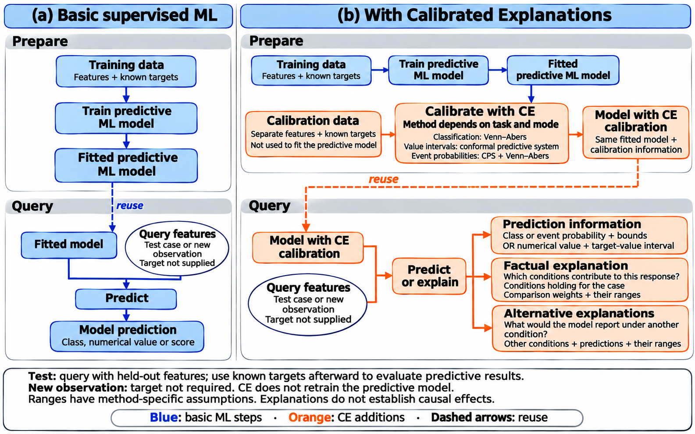
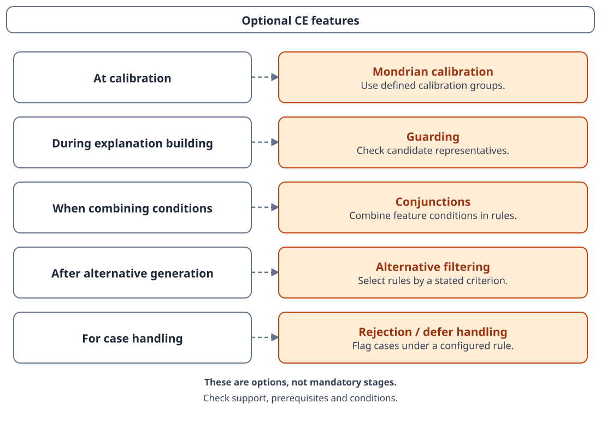

# CE big picture in 60 seconds

<span class="ce-choice-page" hidden></span>

Your model predicts a class or a number. Before using the result, you may also
want to inspect its uncertainty information, understand which feature conditions
contribute, and compare what the model would report under other conditions.

**Calibrated Explanations (CE) brings those questions into one workflow.** It
uses your {term}`fitted model <Fitted model>` and separate labelled
{term}`calibration data <Calibration data>` to provide calibrated prediction
information, factual explanations and alternative explanations with reported ranges.
Start with the comparison below, choose your question, then try one example.
Optional capabilities are introduced afterward.

## From a conventional prediction to CE

Read the two panels together. **(a)** shows a basic model-only workflow.
**(b)** shows what CE adds around the same fitted predictive model. Both separate
**preparation** from **querying** a test case or a new observation.

<figure id="ce-core-comparison">
<a href="../_static/figures/ce-core-comparison.png" aria-label="Open the full-size comparison of basic ML and CE workflows">
<picture>
<source media="(max-width: 600px)" srcset="../_static/figures/ce-core-comparison-mobile.png">

</picture>
</a>
<figcaption>Blue: basic ML steps. Orange: CE additions. Dashed arrows reuse prepared resources. Output branches are capabilities, not a required sequence of API calls.</figcaption>
</figure>

[Open the full-size comparison](../_static/figures/ce-core-comparison.png)
or [the stacked mobile figure](../_static/figures/ce-core-comparison-mobile.png).

1. **Prepare: train, then calibrate.** Training features and known targets fit
   the predictive model. CE additionally uses separate labelled calibration cases.
   Calibration can fit internal calibrators and retain reference information;
   it does not refit the underlying predictive model. An already fitted model
   can be reused instead of training it again.
2. **Query: supply the case's features.** Both routes reuse their prepared
   resources. The model-only route returns a class, numerical value or score.
   CE can report prediction information with a mode-specific range, factual
   conditions with comparison weights and ranges, or alternative conditions
   with predictions and ranges. The case's target is not required.
3. **Test: keep the target aside until evaluation.** A held-out test observation
   can be a query. Supply only its features to prediction or explanation calls,
   then use its known target to assess predictive results. A new observation
   uses the same calls, but its target may not yet be known. Target agreement
   alone does not validate an explanation.

The calibration method follows the task and output question: classification uses
Venn–Abers; numerical-value intervals use a **conformal predictive system (CPS)**;
event probabilities use CPS with Venn–Abers. These ranges have different meanings
and assumptions. The next section helps you choose the question before reading
an output.

This compares CE with a basic model-only workflow; other ML approaches can also
include calibration and explanation methods. The figure describes a fixed-model
workflow, not a complete deployment design or a guarantee under distribution
change. If the predictive model changes, do not assume its existing CE calibration
remains valid.

**Go deeper:** {doc}`why CE was developed <../sections/what-and-why>` and
{doc}`how the workflow is constructed <../sections/how-ce-works>`.

## Tasks and modes: what question are you asking?

A {term}`task <Predictive task>` describes what a supervised model learns to
predict from labelled examples. **Classification** predicts a category: two
classes for binary classification, three or more for multiclass. **Regression**
predicts a numerical {term}`target <Target>`.

A {term}`CE mode <CE mode>` describes the question you ask about that prediction:

- **Which category, and how probable?** For example, a flower’s species. Read
  class probabilities and their bounds in the {doc}`classification example <example-classification>`.
- **What numerical value, and within what interval?** For example, an area’s
  median housing value. Read a value and interval in target units in the
  {doc}`interval-regression example <example-interval>`.
- **How probable is a numerical event?** For example, housing value at most a
  budget. Read probability information for that event in the
  {doc}`probabilistic-regression example <example-event>`.

The two housing questions can use the same fitted regressor. Changing the
question changes the reported quantity and range meaning, not the target it learned.

**Go deeper:** {doc}`tasks, modes and capabilities <../foundations/concepts/tasks_modes_capabilities>`.

## Capabilities: read one result in two complementary ways

First identify the **prediction information** and its range. Then ask:

**“Which conditions contribute to this response?”** A factual explanation reports
conditions holding for the case, with comparison weights and their ranges. For
an Iris flower, these conditions concern its measurements. A weight compares
model responses; it is not another probability that the flower belongs to a species.

**“What would the model report under a different condition?”** An alternative
explanation reports the prediction and range under that condition. It helps you
compare model responses before separately investigating whether a real change
would be feasible or useful.

The explained quantity follows the mode: class probability, a value in target
units, or event probability. Read a weight and an alternative on that same scale.
Ranges have method-specific assumptions; these comparisons do not establish
real-world causal effects.

**Go deeper:** {doc}`how explanations are built <../foundations/concepts/how_explanations_are_built>`
and {doc}`what CE ranges mean <../foundations/concepts/calibrated_interval_semantics>`.

## Choose how to try CE

<div class="ce-route-grid" role="navigation" aria-label="Try CE in a browser or locally">
<a class="ce-route-card" href="expert-hub.html">
<div><strong>Try CE in your browser</strong></div>
<div>Use built-in examples without installing Python. Prepare, calibrate and inspect one result.</div>
<span>Open the browser guide →</span>
</a>
<a class="ce-route-card" href="first-python-explanation.html">
<div><strong>Install and run locally</strong></div>
<div>Install CE, run the Iris example and interpret its output and plot.</div>
<span>Open the Python guide →</span>
</a>
</div>

For local numerical targets, follow the {doc}`regression tutorial <quickstart_regression>`.
For package and environment options, use {doc}`installation <installation>`.
You can also {ref}`read one Iris result without running code <classification-one-case>`.

## When you need more than the basic workflow

[Return to the workflow figure](#from-a-conventional-prediction-to-ce).
Follow one housing case through it: a fitted model estimates an area’s median
housing value; CE uses separate labelled calibration cases and can explain the
result. You may ask either for a **value and interval** or for the **probability
of a value at most a budget**. Keep that question fixed when reading an explanation.

The options below address different needs within this same flow. They are not
extra predictive tasks or settings everyone must enable.

<figure>
<picture>
<source media="(max-width: 600px)" srcset="../_static/figures/ce-optional-features-mobile.svg">

</picture>
<figcaption>Separate options for separate needs. Check supported tasks, modes, prerequisites and conditions in each guide.</figcaption>
</figure>

[Open the full-size optional-feature figure](../_static/figures/ce-optional-features.svg).


**Combining conditions:** the figure also shows conjunctions, which combine
feature conditions into a rule. See {doc}`interpreting explanations <../foundations/how-to/interpret_explanations>`
for the rule context. The walkthrough below follows calibration groups, guarding,
alternative selection and rejection through one housing example.

### At calibration: should regions be treated separately?

In the core comparison above, find **Calibration data** entering **Calibrate with CE**. The calibration procedure
uses these cases’ known outcomes to construct prediction information.

Suppose your application defines Region A and Region B. With
{term}`Mondrian calibration <Mondrian calibration>`, also called conditional
calibration, you supply or derive a group label for each calibration case and
query. For a new area assigned to Region A, the selected construction uses Region A’s
calibration cases rather than treating all regions as one calibration group. You still use the fitted predictive model and the same housing target;
the group-specific calibration can change the reported prediction information
and its range.

Use this option when the grouping is relevant to your application and the
method’s conditions are appropriate. The available calibration cases within each
group matter; defining regions alone does not establish fairness or guarantee improved results.

**Learn next:** {doc}`supply group labels and check the conditional setup <../foundations/how-to/conditional_calibration>`.
For a numerical target, keep the selected {doc}`value or event question <../foundations/concepts/probabilistic_regression>`.

### While building explanations: are candidate conditions supported?

Return to the core comparison’s **factual and alternative explanation outputs**.
To construct them, CE considers feature conditions. A **candidate** is a condition
being considered for a rule, before it appears in the returned explanation.

For the housing case, changing an income condition while leaving the other
features fixed might create a combination poorly represented in the calibration
data. {term}`Guarded explanations <Guarded explanation>` check selected test
copies of the case, with feature values replaced by representatives of candidate
conditions. The configured guard rule decides which candidates to retain.

Read the returned rules alongside the **audit**, which reports counts of tested
and removed candidates. Passing checks at representatives does not certify every
value in a numerical interval, or automatically check whether the original
area’s full feature combination is supported by the calibration data. Guarding is a check during explanation construction, not a general
certificate for the prediction.

**Learn next:** {doc}`understand the guard, supported configuration and audit <../foundations/concepts/guarded_explanations>`.

### After generating alternatives: which ones should I inspect?

Look at the **Alternative explanations** output in the core comparison. One case can have several rules,
each reporting a prediction under a different condition. You can inspect them
all or select a subset for a stated purpose, whether or not you used a guard.

{term}`Alternative filtering <Alternative filtering>` selects from those existing
rules. For example, an **ensured** filter keeps alternatives whose reported
prediction interval is no wider than the original prediction interval. Width
here means the difference between the reported upper and lower values. For a
value question, compare target-value interval widths; for an event question,
compare probability-bound widths. Keep the quantity and scale the same.

Other criteria also need their mode: crossing a probability comparison boundary
is a different question from obtaining a lower numerical house-value prediction.
Filtering helps organize what you inspect. It does not prove that changing an
area’s income would cause the alternative outcome, or that a narrower reported
range improves predictive accuracy.

**Learn next:** {doc}`choose an alternative filter and read its mode-specific criterion <../foundations/concepts/alternatives>`.

### When using the prediction: should some cases be flagged or set aside?

Return to **Prediction information** in the core comparison. Your application may
need to treat some cases differently rather than use every result in the same way.
{term}`Rejection <Rejection>` identifies cases under a supported, task-specific
rejection procedure. A **reject policy** controls how that status affects handling—for example,
tagging cases or selecting cases for explanation. Your application decides the
follow-up action.

For the housing example, the reviewed regression rejection procedure requires
a defined event threshold, such as the budget used for the event-probability
question. A wide house-value interval alone is not that procedure. Classification
has its own construction and interpretation; do not transfer the regression setup
or its assumptions unchanged to another task.

The distinction is the item being handled: alternative filters select explanation
rules; rejection concerns queried cases. A case can have a model prediction while
also receiving a rejection status under the configured procedure.

**Learn next:** {doc}`configure rejection for your task and interpret the returned status <../practitioner/advanced/reject-policy>`.

Choose only the options your problem needs. Their supported combinations and
statistical conditions depend on the task, mode, configuration and software
version. The browser guide and Python guides identify their own available controls.
For the meaning of each range, keep the shared
{doc}`range guide <../foundations/concepts/calibrated_interval_semantics>` nearby.

## Continue learning

- **Why was CE developed?** {doc}`CE: What & Why <../sections/what-and-why>`.
- **How do I read my result?** {doc}`Interpret explanations <../foundations/how-to/interpret_explanations>`.
- **How do I use my own data?** {doc}`CE in Practice <../sections/in-practice>`.
- **How do I integrate the library?** {doc}`Software & Integration <../sections/software-integration>`.

<!-- Entry-point tier: Tier 1. -->

```{toctree}
:hidden:
:maxdepth: 1

Classification example <example-classification>
Interval regression example <example-interval>
Event-probability example <example-event>
First explanation in Python <first-python-explanation>
Browser workflow: Expert Hub <expert-hub>
Decision practice: Decision Lab <decision-lab>
```

<!-- Preserve previous section links. -->
<span id="1-ce-in-60-seconds"></span>
<span id="2-choose-your-predictive-task-and-ce-mode"></span>
<span id="3-choose-your-browser-experience"></span>
<span id="4-explore-one-explanation"></span>
<span id="5-understand-what-you-see"></span>
<span id="6-continue-learning"></span>
<span id="choose-one-step-by-step-example"></span>
<span id="choose-your-next-step"></span>
<span id="get-started"></span>
<span id="if-the-result-differs-or-no-plot-appears"></span>
<span id="install"></span>
<span id="keep-the-data-roles-separate"></span>
<span id="predictive-tasks"></span>
<span id="quickstart"></span>
<span id="quickstart-create-and-read-your-first-explanation"></span>
<span id="read-the-plot"></span>
<span id="run-the-complete-example"></span>
<span id="task-mode-and-capability-three-different-choices"></span>
<span id="what-can-you-rely-on"></span>
<span id="what-ce-adds"></span>
<span id="what-ce-adds-to-the-workflow"></span>


<!-- Preserve headings from the preceding review candidate. -->
<span id="quick-start-the-ce-big-picture"></span>
<span id="what-changes-when-you-add-ce"></span>
<span id="choose-the-question-you-want-to-answer"></span>
<span id="what-can-an-explanation-tell-you"></span>
<span id="what-do-the-ranges-mean"></span>
<span id="after-your-first-result"></span>
<span id="go-deeper-when-you-need-it"></span>

<span id="capabilities-what-can-ce-show-you"></span>
