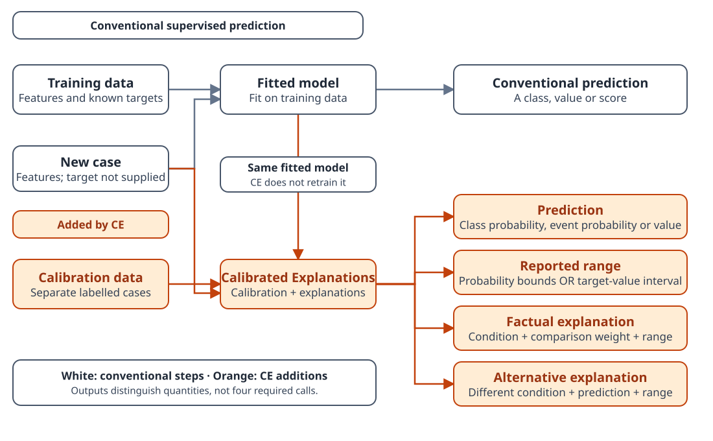

# CE big picture in 60 seconds

<span class="ce-choice-page" hidden></span>

Your model predicts a class or a number. Before using the result, you may also
want to inspect its uncertainty information, understand which feature conditions
contribute, and compare what the model would report under other conditions.

**Calibrated Explanations (CE) brings those questions into one workflow.** It
uses your {term}`fitted model <Fitted model>` and separate labelled
{term}`calibration data <Calibration data>` to provide calibrated prediction
information, factual explanations and alternative explanations with reported ranges.
Read the overview first; open an optional question below when you want more depth.

## From a conventional prediction to CE

<figure>
<picture>
<source media="(max-width: 600px)" srcset="../_static/figures/ce-big-picture-mobile.svg">

</picture>
<figcaption>CE uses the same fitted model. The orange outputs distinguish quantities; they are not four required API calls.</figcaption>
</figure>

[Open the full-size figure](../_static/figures/ce-big-picture.svg).

The white route shows a conventional prediction: the fitted model uses a new
case’s {term}`features <Feature>` to return a class, value or score. The orange
route adds calibration using separate cases with known outcomes, then explains
the calibrated response for the new case. Its unknown target is not an input.
CE does not retrain that predictive model; keep evaluation data separate to check
results. Other tools also offer calibration or explanations—CE combines them
around the calibrated response.

**Go deeper:** {doc}`why CE was developed <../sections/what-and-why>` and
{doc}`how the workflow is constructed <../sections/how-ce-works>`.

## Tasks and modes: what question are you asking?

A {term}`task <Predictive task>` describes what a supervised model learns to
predict from labelled examples. **Classification** predicts a category: two
classes for binary classification, three or more for multiclass. **Regression**
predicts a numerical {term}`target <Target>`.

A {term}`CE mode <CE mode>` describes the question you ask about that prediction:

- **Which category, and how probable?** For example, a flower’s species. Read
  class probabilities and their bounds in the {doc}`classification example <example-classification>`.
- **What numerical value, and within what interval?** For example, an area’s
  median housing value. Read a value and interval in target units in the
  {doc}`interval-regression example <example-interval>`.
- **How probable is a numerical event?** For example, housing value at most a
  budget. Read probability information for that event in the
  {doc}`probabilistic-regression example <example-event>`.

The two housing questions can use the same fitted regressor. Changing the
question changes the reported quantity and range meaning, not the target it learned.

**Go deeper:** {doc}`tasks, modes and capabilities <../foundations/concepts/tasks_modes_capabilities>`.

## Capabilities: read one result in two complementary ways

First identify the **prediction information** and its range. Then ask:

**“Which conditions contribute to this response?”** A factual explanation reports
conditions holding for the case, with comparison weights and their ranges. For
an Iris flower, these conditions concern its measurements. A weight compares
model responses; it is not another probability that the flower belongs to a species.

**“What would the model report under a different condition?”** An alternative
explanation reports the prediction and range under that condition. It helps you
compare model responses before separately investigating whether a real change
would be feasible or useful.

The explained quantity follows the mode: class probability, a value in target
units, or event probability. Read a weight and an alternative on that same scale.
Ranges have method-specific assumptions; these comparisons do not establish
real-world causal effects.

**Go deeper:** {doc}`how explanations are built <../foundations/concepts/how_explanations_are_built>`
and {doc}`what CE ranges mean <../foundations/concepts/calibrated_interval_semantics>`.

## When you need more than the basic workflow

After understanding one result, choose an extension for a specific need.
**Calibration constructs prediction information; explanation filters select
rules; rejection handles cases.** They have different jobs. Availability,
criteria and statistical conditions depend on the task, mode and configuration;
check the linked guide for your software version and browser or Python route.

<details><summary>Do defined groups need separate calibration treatment? — Mondrian calibration</summary>

Suppose your housing application defines regional groups. A single collection
of calibration cases may mix those groups, while your question concerns one of
them. {term}`Mondrian calibration <Mondrian calibration>`, also called conditional
calibration, uses group labels in the applicable calibration construction.
The query uses its group information when obtaining prediction information.

This option belongs at the **calibration stage**. Use the group-label procedure
consistently for calibration and queries. The selected method’s conditions and
available group data matter; small groups can limit usefulness. Grouping alone
does not establish fairness or guarantee improved predictions.

Continue with {doc}`conditional calibration <../foundations/how-to/conditional_calibration>`
for setup, supported label channels and limitations. Read its conditions for your
selected task and mode rather than transferring one guarantee to every group.

</details>

<details><summary>Which alternatives should I inspect? — Alternative filtering</summary>

One case can have several alternatives. {term}`Alternative filtering <Alternative filtering>`
selects existing alternative rules according to a stated criterion, after they
have been generated. For example, you may want to inspect prediction-changing
alternatives or compare their reported interval widths.

The selection criterion needs its mode. Probability-based filters and numerical
regression filters use different comparisons. An **ensured** filter retains
alternatives with intervals no wider than the baseline interval on the same
output scale. That is a width comparison, not a guarantee of a beneficial
intervention or improved predictive accuracy.

Continue with {doc}`alternative explanations and filters <../foundations/concepts/alternatives>`
to understand the criteria before choosing a method. Filtering rules does not
retrain the predictive model or, by itself, reject the queried case.

</details>

<details><summary>Are the candidate conditions supported by the data? — Guarded explanations</summary>

Changing one feature while keeping the others can produce an unusual combination
of values. {term}`Guarded explanations <Guarded explanation>` check representative
hypothetical inputs using calibration-data support information and filter
candidate conditions before emitting rules.

This check belongs to **explanation construction**. It examines selected
representatives, not every point in a numerical interval. It also does not
automatically certify that the original query is in distribution. Inspect the
audit alongside the returned rules, especially if few or none remain.

Continue with {doc}`guarded explanations <../foundations/concepts/guarded_explanations>`
for the rule, standard-explainer prerequisites, options and audit. Read the
applicable limitations for your task and configuration; support filtering is
not a new universal prediction guarantee.

</details>

<details><summary>Should the application handle some cases differently? — Rejection</summary>

An application may need to flag or set aside a case under a defined rejection
procedure, even when a model prediction is available. {term}`Rejection <Rejection>`
identifies cases under that procedure. A **reject policy** controls their tagging,
selection or return handling; the application decides what to do next.

This concerns **cases**, rather than selecting explanation rules. The procedure
is task-specific. In the reviewed source version, **regression rejection requires
an event threshold**: a numerical prediction interval alone is not its rejection
procedure. Classification has its own construction. In the reviewed multiclass procedure,
a two-label representation concerns whether the model’s top prediction is correct;
those labels are not the original flower species. Read its metadata using the
procedure’s definitions.

Continue with the {doc}`reject-policy guide <../practitioner/advanced/reject-policy>`
for supported configurations, return handling and the regression event contract.
Do not infer rejection behavior from a displayed probability or interval width alone.

</details>

## Choose how to try CE

<div class="ce-route-grid" role="navigation" aria-label="Try CE in a browser or locally">
<a class="ce-route-card" href="expert-hub.html"><strong>Try CE in your browser</strong><span>Use built-in examples without installing Python. Prepare, calibrate and inspect one result.</span><span>Open the browser guide →</span></a>
<a class="ce-route-card" href="first-python-explanation.html"><strong>Install and run locally</strong><span>Install CE, run the Iris example and interpret its output and plot.</span><span>Open the Python guide →</span></a>
</div>

For local numerical targets, follow the {doc}`regression tutorial <quickstart_regression>`.
For package and environment options, use {doc}`installation <installation>`.
You can also {ref}`read one Iris result without running code <classification-one-case>`.

## Continue learning

- **Why was CE developed?** {doc}`CE: What & Why <../sections/what-and-why>`.
- **How do I read my result?** {doc}`Interpret explanations <../foundations/how-to/interpret_explanations>`.
- **How do I use my own data?** {doc}`CE in Practice <../sections/in-practice>`.
- **How do I integrate the library?** {doc}`Software & Integration <../sections/software-integration>`.

<!-- Entry-point tier: Tier 1. -->

```{toctree}
:hidden:
:maxdepth: 1

Classification example <example-classification>
Interval regression example <example-interval>
Event-probability example <example-event>
First explanation in Python <first-python-explanation>
Browser workflow: Expert Hub <expert-hub>
Decision practice: Decision Lab <decision-lab>
```

<!-- Preserve previous section links. -->
<span id="1-ce-in-60-seconds"></span>
<span id="2-choose-your-predictive-task-and-ce-mode"></span>
<span id="3-choose-your-browser-experience"></span>
<span id="4-explore-one-explanation"></span>
<span id="5-understand-what-you-see"></span>
<span id="6-continue-learning"></span>
<span id="choose-one-step-by-step-example"></span>
<span id="choose-your-next-step"></span>
<span id="get-started"></span>
<span id="if-the-result-differs-or-no-plot-appears"></span>
<span id="install"></span>
<span id="keep-the-data-roles-separate"></span>
<span id="predictive-tasks"></span>
<span id="quickstart"></span>
<span id="quickstart-create-and-read-your-first-explanation"></span>
<span id="read-the-plot"></span>
<span id="run-the-complete-example"></span>
<span id="task-mode-and-capability-three-different-choices"></span>
<span id="what-can-you-rely-on"></span>
<span id="what-ce-adds"></span>
<span id="what-ce-adds-to-the-workflow"></span>


<!-- Preserve headings from the preceding review candidate. -->
<span id="quick-start-the-ce-big-picture"></span>
<span id="what-changes-when-you-add-ce"></span>
<span id="choose-the-question-you-want-to-answer"></span>
<span id="what-can-an-explanation-tell-you"></span>
<span id="what-do-the-ranges-mean"></span>
<span id="after-your-first-result"></span>
<span id="go-deeper-when-you-need-it"></span>

<span id="capabilities-what-can-ce-show-you"></span>
