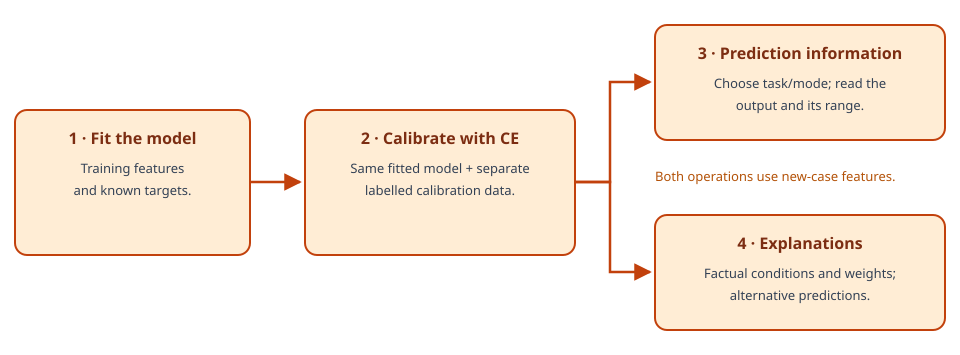

# How CE Works

<!-- Preserve descriptive anchors from the previous review layout. -->
<span id="choose-an-output-to-understand"></span>
<span id="follow-the-workflow"></span>


How does CE turn a trained model and calibration data into prediction information
and an explanation? This route moves from the workflow to mechanisms and their
statistical conditions. You can stop at the depth needed for your question.

## Follow the same model through the workflow

<figure>
<picture>
<source media="(max-width: 600px)" srcset="../_static/figures/ce-how-workflow-mobile.svg">

</picture>
<figcaption>CE's conceptual lifecycle. Orange boxes identify the stages; the figure background is transparent. After calibration, prediction and explanation are separate operations, not a compulsory sequence of calls.</figcaption>
</figure>

[Open the full-size workflow](../_static/figures/ce-how-workflow.svg).

1. **Fit the predictive model.** Training examples contain features and known
   targets. Fitting learns the predictive model. If your model is already fitted,
   CE can use it without requiring you to train it again.
2. **Calibrate with separate labelled data.** CE uses that fitted model and
   calibration examples not used to fit it. Calibration supports the prediction
   information appropriate to your task and mode; it is not another model-fitting
   step. Keep evaluation data separate to check the resulting system.
3. **Read prediction information for a new case.** Supply its features and choose
   the question: a class probability, a numerical value with an interval, or the
   probability of an event on a numerical target. Identify the quantity and units
   before reading its range.
4. **Inspect factual or alternative explanations.** A factual explanation reports
   conditions holding for the case and their weights with ranges. Alternatives
   report the model's predictions under different conditions. An explanation call
   can obtain the prediction information it needs; a separate prediction call is
   not a prerequisite. Neither explanation establishes a real-world causal effect.

For the inputs to these stages, read the shared
{doc}`data-role definitions <../foundations/concepts/predictive_tasks>`.
For the calls, use {doc}`Quick API <../get-started/quick_api>`. A completed workflow
alone does not verify the statistical assumptions: guarantees remain mode-specific
as described in the {doc}`semantics reference <../foundations/concepts/calibrated_interval_semantics>`.

## Read the workflow at three depths

**The overview:** the fitted model supplies predictions, separate labelled
calibration data support the calibration procedure, and CE produces prediction
information and explanations for a new case. Calibration uses known targets;
explaining a new case does not require knowing that case's target in advance.

**The mechanism:** a factual explanation compares the calibrated output with
responses obtained under feature conditions. For a simple difference, subtracting
a comparison response from the original response gives a weight. The exact
construction and aggregation matter: it is not a causal effect or a universal
formula for every explanation type. Follow the
{doc}`worked construction <../foundations/concepts/how_explanations_are_built>`
to understand the comparisons and their units.

**The statistical detail:** calibration means different things for different
outputs. Start with the
{doc}`calibration background <../foundations/concepts/calibration_background>`;
then use the {doc}`canonical semantics <../foundations/concepts/calibrated_interval_semantics>`
for CE's method-specific assumptions and limitations. You do not need to read
all the theory before trying an example.

## Choose what to understand next

| Your question | Shared explanation | Afterward |
| --- | --- | --- |
| Which output answers my task? | {doc}`Tasks, modes and capabilities <../foundations/concepts/tasks_modes_capabilities>`. | Try that route in the browser or Python. |
| What is calibration, and how do the statistical methods differ? | {doc}`Calibration and statistical background <../foundations/concepts/calibration_background>`. | Check source-version assumptions and literature. |
| How does a feature become a weight or alternative? | {doc}`How explanations are built <../foundations/concepts/how_explanations_are_built>`. | Read the resulting rules and plot. |
| How do I interpret an actual object or figure? | {doc}`Interpret CE explanations <../foundations/how-to/interpret_explanations>`. | Compare one real example. |
| What can the method guarantee? | {doc}`Canonical interval semantics <../foundations/concepts/calibrated_interval_semantics>`. | Check that the assumptions fit the intended use. |

## Keep the quantities separate

Class-probability bounds concern a probability. A numeric prediction interval
concerns target values in their units. A threshold-event probability concerns a
defined event on that target. Feature-weight ranges concern model-response
comparisons. A similar-looking bar does not make them interchangeable.

The {doc}`regression-mode guide <../foundations/concepts/probabilistic_regression>`
shows how the same model can answer value and event questions. The
{doc}`explanation-construction page <../foundations/concepts/how_explanations_are_built>`
separates baseline predictions, factual weights and alternative predictions.

## Go deeper without restarting

Use {doc}`shared foundations <../foundations/index>` as a topic collection,
and {doc}`theory and literature <../researcher/advanced/theory_and_literature>`
for papers. Statistical claims need their method, assumptions and version;
this introduction does not strengthen the canonical guarantees or resolve
open author-review issues.

**See it happen:** {doc}`browser Quickstart <../get-started/index>`.
**Run a task:** {doc}`CE in Practice <in-practice>`.
**Integrate an implementation:** {doc}`Software & Integration <software-integration>`.

```{toctree}
:maxdepth: 1
:hidden:

Shared foundations <../foundations/index>
Read CE explanations <../foundations/how-to/interpret_explanations>
```

Entry-point tier: Tier 1.
