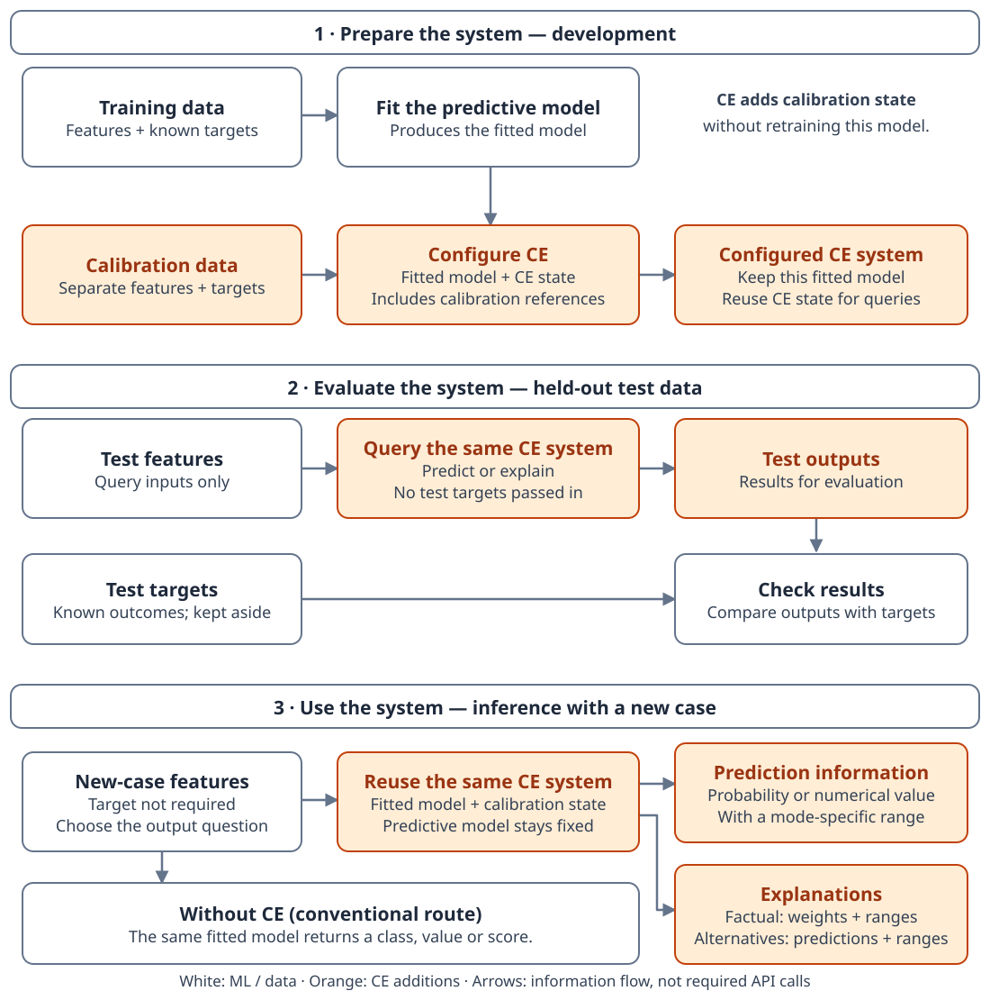

# How CE Works

<span class="ce-choice-page" hidden></span>

<!-- Preserve descriptive anchors from the previous review layout. -->
<span id="choose-an-output-to-understand"></span>
<span id="follow-the-workflow"></span>


How does CE turn a trained model and calibration data into prediction information
and an explanation? This route moves from the workflow to mechanisms and their
statistical conditions. You can stop at the depth needed for your question.

## Read this path as a tutorial

The shared chapters provide the detailed teaching, code and output. Start with
{doc}`data roles <../foundations/concepts/predictive_tasks>` if features, targets
or calibration sets are new. Then work through
{doc}`calibration and its methods <../foundations/concepts/calibration_background>` →
{doc}`explanation construction <../foundations/concepts/how_explanations_are_built>` →
{doc}`interpretation <../foundations/how-to/interpret_explanations>`.
The same Iris session continues across those chapters. The overview below helps
you see how they connect; it is not a second copy of their detailed explanations.

## Follow the same model through the workflow

<figure>
<picture>
<source media="(max-width: 600px)" srcset="../_static/figures/ce-reference-workflow-mobile.svg">

</picture>
</figure>

[Open the full-size figure](../_static/figures/ce-reference-workflow.svg).

The blue route shows a conventional predictive workflow; the orange route shows
CE's additions around the same fitted model. Other ML workflows can also include
calibration and uncertainty methods. The labelled dataset is separated into
training, calibration and evaluation roles. A new query needs features, not its
unknown target. Interpret one result directly; evaluate performance on separate
labelled cases. These are different activities.

1. **Fit the predictive model.** Training examples contain features and known
   targets. Fitting learns the predictive model. If your model is already fitted,
   CE can use it without requiring you to train it again.
2. **Calibrate with separate labelled data.** CE uses that fitted model and
   calibration examples not used to fit it. Calibration supports the prediction
   information appropriate to your task and mode; it is not another model-fitting
   step. Keep evaluation data separate to check the resulting system.
3. **Read prediction information for a new case.** Supply its features and choose
   the question: a class probability, a numerical value with an interval, or the
   probability of an event on a numerical target. Identify the quantity and units
   before reading its range.
4. **Inspect factual or alternative explanations.** A factual explanation reports
   conditions holding for the case and their weights with ranges. Alternatives
   report the model's predictions under different conditions. An explanation call
   can obtain the prediction information it needs; a separate prediction call is
   not a prerequisite. Neither explanation establishes a real-world causal effect.

For the inputs to these stages, read the shared
{doc}`data-role definitions <../foundations/concepts/predictive_tasks>`.
For the calls, use {doc}`Quick API <../get-started/quick_api>`. A completed workflow
alone does not verify the statistical assumptions: guarantees remain mode-specific
as described in the {doc}`semantics reference <../foundations/concepts/calibrated_interval_semantics>`.

## Follow the workflow for your question

The same structure produces different quantities in the three modes. Each
example below starts with a mode-specific figure, then offers browser and local
Python routes. Read the figure together with its assumptions note.

- {doc}`Classification: class-probability information <../get-started/example-classification>`.
- {doc}`Interval regression: value and target-value interval <../get-started/example-interval>`.
- {doc}`Probabilistic regression: event probability and bounds <../get-started/example-event>`.

## From calibration to a prediction

The fitted model supplies responses for new features. CE uses separate labelled
calibration examples to construct prediction information for the chosen question.
Classification uses Venn–Abers constructions. Numerical interval regression uses
a conformal predictive system (CPS); threshold-event probabilities use CPS scores
with Venn–Abers calibration. These methods do not make every returned range mean
the same thing.

Begin with the {doc}`calibration background <../foundations/concepts/calibration_background>`
for intuition and statistical definitions. Then read the applicable mode in the
{doc}`semantics reference <../foundations/concepts/calibrated_interval_semantics>`
for the source version's conditions and limits. The model must be fixed before
calibration; query targets are not inputs to prediction or explanation.

## From a prediction to an explanation

A factual explanation compares the calibrated response with responses obtained
under feature conditions. In a simple difference, the original response minus a
comparison response gives a weight. Its units depend on the explained quantity:
probability differences for a class or event, target-unit differences for numerical
regression. Exact construction and aggregation matter; this is not a universal
formula for every explanation type.

An alternative instead reports the model's prediction under another condition.
It is not the same quantity as a factual weight. Follow the
{doc}`worked explanation construction <../foundations/concepts/how_explanations_are_built>`
and then {doc}`read the resulting rules and plot <../foundations/how-to/interpret_explanations>`.
Neither type establishes the causal effect of changing the real-world case.

## What the method's assumptions do

Calibration depends on the data and method's sampling conditions. A successful
call does not check that future cases satisfy them, and one correct result does
not establish calibration or coverage. Use the mode-specific semantics to
separate the output definition from its guarantee, and
{doc}`Checking results <../practitioner/check_results>` to plan held-out evaluation.
That is the bridge from understanding the construction to applying it.

## Find the explanation you need

| Your question | Shared explanation | Afterward |
| --- | --- | --- |
| Which output answers my task? | {doc}`Tasks, modes and capabilities <../foundations/concepts/tasks_modes_capabilities>`. | Try that route in the browser or Python. |
| What is calibration, and how do the statistical methods differ? | {doc}`Calibration and statistical background <../foundations/concepts/calibration_background>`. | Check source-version assumptions and literature. |
| How does a feature become a weight or alternative? | {doc}`How explanations are built <../foundations/concepts/how_explanations_are_built>`. | Read the resulting rules and plot. |
| How do I interpret an actual object or figure? | {doc}`Interpret CE explanations <../foundations/how-to/interpret_explanations>`. | Compare one real example. |
| What can the method guarantee? | {doc}`Canonical interval semantics <../foundations/concepts/calibrated_interval_semantics>`. | Check that the assumptions fit the intended use. |

## Keep the quantities separate

Class-probability bounds concern a probability. A numeric prediction interval
concerns target values in their units. A threshold-event probability concerns a
defined event on that target. Feature-weight ranges concern model-response
comparisons. A similar-looking bar does not make them interchangeable.

The {doc}`regression-mode guide <../foundations/concepts/probabilistic_regression>`
shows how the same model can answer value and event questions. The
{doc}`explanation-construction page <../foundations/concepts/how_explanations_are_built>`
separates baseline predictions, factual weights and alternative predictions.

## Go deeper without restarting

Use {doc}`shared foundations <../foundations/index>` as a topic collection,
and {doc}`theory and literature <../researcher/advanced/theory_and_literature>`
for papers. Statistical claims need their method, assumptions and version;
this introduction does not strengthen the canonical guarantees or resolve
open author-review issues.

**See it happen:** {doc}`browser Quickstart <../get-started/index>`.
**Run a task:** {doc}`CE in Practice <in-practice>`.
**Integrate an implementation:** {doc}`Software & Integration <software-integration>`.

```{toctree}
:maxdepth: 1
:hidden:

Shared foundations <../foundations/index>
Read CE explanations <../foundations/how-to/interpret_explanations>
```

<!-- Entry-point tier: Tier 1. -->

<span id="read-the-workflow-at-three-depths"></span>
<span id="choose-what-to-understand-next"></span>
